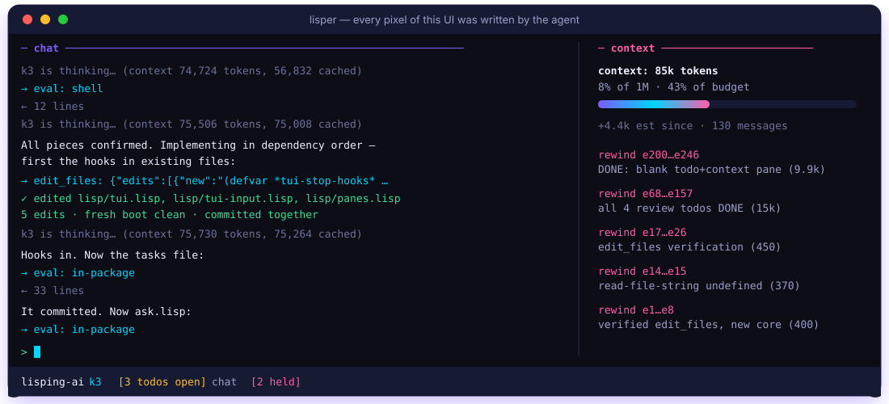
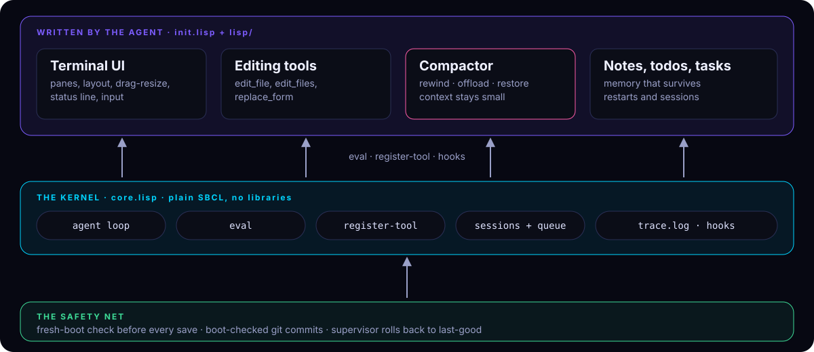

<p align="center">
  
</p>

<p align="center">
  
  
  
  
</p>

<p align="center">
  <b>Emacs grew an editor out of a tiny Lisp kernel.<br>
  lisper grows an AI agent the same way, while the agent is running.</b>
</p>

---

## Meet the agent that builds its own workshop

Most agent harnesses are finished products: you get the tools someone shipped,
and that's it. lisper starts with **one tool, `eval`**, inside a live Lisp image.
Ask it for something and it writes the terminal UI, the editing tools, the
memory and the context manager it needs, then keeps improving them as it hits
their limits.

Nobody scripted those features. It wrote them, and each one passed a fresh-boot
check before it was kept.

<p align="center">
  
</p>

<p align="center"><sub>Every pane, separator, status line and token counter on this screen was written by the agent itself.</sub></p>

## Why you'll want it

| | |
|---|---|
| 🧬 **Self-improving** | It fixes its own tools when it hits their limits, and keeps a change only if a fresh boot proves it works. |
| 🪶 **Tiny kernel, zero lock-in** | Plain SBCL, no libraries. Every behaviour is a hook the agent can replace, not a feature you have to live with. |
| ♾️ **Context that never fills up** | It collapses finished work into short summaries (*rewind*), so a long session neither ends nor slows down. |
| 🛟 **Crash-proof** | The conversation is saved before every tool call. Restart, crash or kill it, and it resumes where it was. |
| 🔒 **Safe to let loose** | Everything is in git, every commit is boot-checked, and a supervisor rolls back anything that stops it from starting. |
| 🔌 **Bring your own model** | Any OpenAI-compatible Chat Completions endpoint. Built against Kimi. |

## Get it running in 30 seconds

```sh
cp .env.example .env     # set OPENAI_BASE_URL, OPENAI_API_KEY, MODEL
./run.sh                 # supervised; talk to it in the terminal
```

Watch it think, or reach it from anywhere:

```sh
tail -f ~/.lisper/sessions/main/trace.log
echo "build me a weather pane" >> ~/.lisper/sessions/main/queue.txt
```

Needs SBCL (`.tool-versions` pins it for asdf), git and curl.

## The numbers

<p align="center">
  
</p>

<p align="center"><sub>Measured over one real run: 768 requests, 50.6M input tokens.</sub></p>

## How it's built

<p align="center">
  
</p>

A small kernel, a layer the agent writes itself, and a safety net under both.

### The power of rewind

The kernel has no context management. It only reports the context size and
leaves `*messages*` to the model. The model built a compactor
(`lisp/context.lisp`): every message gets an entry id, and `context_rewind`
collapses a finished stretch (`e68…e157`) into a one-line summary it writes
itself, while `context_offload` moves a big tool result to a file. The
originals are kept, so `context_restore` can bring one back. Those are the
`rewind …` lines in the context pane above.

- **Almost always enough.** 21 rewinds and 16 offloads, and only one restore.
- **Pays for itself.** A rewind costs fresh (uncached) tokens once and saves on
  every later request. One shrank the context from 109.6k to 31.8k tokens: 20.5k
  fresh tokens once, then 77.8k fewer on each following request. A typical one
  costs 1–6k once and saves 5–78k per request.
- **Cache stays warm.** Of the 50.6M input tokens only about 1.8M were fresh.
  Kimi's prefix cache hit about 99.7% of what it could cache.
- **Small working set.** Before the compactor, on K2.7, requests averaged 76.8k
  tokens. With it, on K3, the working context sits around 5–20k (recent
  requests 5–7k), with 1M available. It doesn't try to fit the window. It keeps
  only what the current task needs.

### Changes that can't break it

Like Emacs, with a safety net:

- At boot the core loads `init.lisp`, like `init.el`, and it loads the model's
  other files with `load-file`. A form that fails is reported to the model and
  skipped.
- `eval` with only `code` changes the running image, like `M-:`.
- `eval` with a `file` argument writes the file verbatim, like saving a buffer.
  Before the running image sees it, a fresh SBCL boots with the new file in
  place (`test-boot`); only if that's clean is the file loaded into the running
  image and committed, like `eval-buffer`. Otherwise the old version is put back
  and the image is untouched. A function that's called but never defined
  anywhere also counts as a problem.
- git keeps the history. If a boot crashes, the supervisor (`run.sh`) rolls the
  files back to the last commit that booted (tag `last-good`).

### Everything is a hook

The core's own functions are locked, but its hooks are plain variables and
functions the model may replace: `*system-prompt*`, `*emit*` (where events go),
`*complete*` (how the model is called), `*before-request*`, `*messages*` (its
own context), and the terminal and queue input loops. Every event is also
written to the session's `trace.log` by the core, whatever the model changes.

### Sessions that pick up where they left off

One session is one process: the same code, with its own conversation and
working directory. Code lives in the repo; everything else lives in
`~/.lisper/` (`LISPER_HOME`):

```
~/.lisper/
  notes.md                    shared data (home-path)
  sessions/main/              per session (session-path)
    messages.json, meta.json  conversation and cwd, saved after every step
    queue.txt, trace.log      message queue and live trace
    todos.txt, layout.lisp    the model's per-session state
```

- `LISPER_SESSION=name ./run.sh` starts or resumes session `name` (default
  `main`). Several sessions can run at once. Each one's whole-file writes are
  refused if another session changed the file since it last looked.
- `LISPER_CWD=dir` sets the session's working directory, where `shell` runs. It's
  saved with the session.
- A restart (crash, SIGUSR1, `restart-image`) resumes the conversation where it
  was. The conversation is saved before tool calls run, so even a tool that
  kills the process leaves the turn recoverable. `LISPER_FRESH=1` starts without
  the saved conversation. If the image crashes three times in a row soon after
  starting, the supervisor sets the conversation aside and starts fresh.
- On exit, `run.sh` prints the command that resumes the session. Inside, the
  kernel offers `(session-list)` (every session with its cwd, size, first
  message and whether a process has it) and `(session-switch name)`, which saves
  this session and has the supervisor start the other one in its place. The
  model builds the `/resume` command on top of them.
- `~/.lisper` is its own git repo, committed after every turn (transcripts and
  logs excluded), so a bad rewrite of the model's notes can be undone.

## Configuration

- `LISPING_DOTENV=path` reads settings from another file.
- `LISPING_HEADLESS=1` starts it without terminal input.
- `LISPING_NO_TUI=1` skips the UI the model built for itself.
- Messages sent while the model is mid-turn wait until it's done, then arrive
  one per turn. Start a message with `!` to interrupt: it goes in before the
  model's next call.
- `pkill -USR1 -f boot.lisp` restarts the image through the supervisor; SIGTERM
  stops it (and the supervisor with it).

## The experiment

lisper is an experiment in a self-developing harness. The question: if an agent
starts with almost nothing, just a way to run code in its own live process, can
it grow the harness it works in, the way people grow an Emacs config?

**Setup.** The kernel stays small and unopinionated; where the model might want
something different, the kernel exposes a hook instead of a feature. The model
(Kimi K2.7 in the first runs, then K3 with a 1M context) is told what it is and
how the image works, then given tasks. The first one was a tmux-like terminal UI
with a chat pane and a wttr.in weather pane. A second agent acts as its manager:
it watches the session's `trace.log`, steers the model through the session's
`queue.txt`, reads the model's screen through tmux, and changes the kernel when
the trace shows the kernel is in the way. It doesn't write the model's features.

**What it built in the first two hours**, all of it in its own files: an ANSI
color parser, line buffers and a character grid, a tmux-style layout with a live
weather pane and an input line, raw terminal handling, a crash log for its own
UI, an `edit_file` tool for small edits, and notes to itself.

**What went wrong**, and is the interesting part. Each failure shaped the
kernel:

- *Parentheses.* Long forms with one paren out of place were its most common
  failure, and retyping whole files to fix one paren kept introducing new ones.
  It got past this by checking forms with the Lisp reader and by building
  `edit_file`.
- *Misremembered APIs.* It reached for functions that don't exist in SBCL
  (`define-alien-struct`, `uiop` without loading it) and lost turns on each.
  Error messages now carry hints for misremembered names.
- *Working blind.* It can't see its own screen, so UI bugs were invisible to it
  until it logged crashes to a file and drove its UI through tmux.
- *Live-image bugs.* Stale threads from earlier starts stealing keystrokes; a
  string that aliased the input buffer, so every submitted message became empty;
  a failed edit that rolled back the file but left a declaration behind in the
  running image. Automatic saving of definitions was replaced by Emacs-style
  files that are kept only if they load cleanly, and blank messages are now
  dropped so one can't block every request.
- *Forgetting.* Its conversation used to vanish on restart, and until it kept
  notes it relearned the same facts each time. Sessions, a message queue,
  `:user` events and a trace file came out of this.

Each time the rule was the same: fix what the kernel got wrong, expose what the
model needs, and leave the feature to the model.

**Where it's going.** Can it keep its context small on its own, if the kernel
tells it how big the context is? (Yes, see rewind.) Can it cope with a hang,
which the supervisor doesn't catch yet? And the longer goal: a keyboard-less
lab-PC interface, a window manager it can be talked to, that drives electronics
instruments as tools.

## Layout

- `core.lisp`: the kernel. `boot.lisp` loads it; `run.sh` supervises it.
- `init.lisp`, `lisp/`: written and maintained by the model.
- `assets/`: the SVGs in this README.
- `hooks/pre-commit`: boot-checks every commit (installed by `run.sh`).
- `~/.lisper/`: notes, sessions, traces, queues. See above.

---

<p align="center"><sub>Built by an agent, for agents. <code>(register-tool "your-idea" ...)</code></sub></p>
